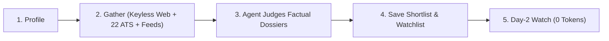

# ULTRON

**U**niversal **L**ocator & **T**riage of **R**oles, **O**penings and **N**iches
(`Universal Locator & Triage of Roles, Openings and Niches`)

[](https://github.com/ERamaM/ULTRON/actions/workflows/ci.yml)
[](https://github.com/ERamaM/ULTRON/actions/workflows/ci.yml?query=branch%3Amain)
[](https://github.com/ERamaM/ULTRON/actions/workflows/codeql.yml)
[](https://sonarcloud.io/summary/new_code?id=ERamaM_ULTRON)
[](https://www.python.org/downloads/)
[](LICENSE)
[](.gitleaks.toml)
[](https://github.com/astral-sh/ruff)
[](#supported-agents)

ULTRON is a production-ready agent skill, deterministic CLI, and stdio MCP server for **Claude Code, Codex, OpenCode, and Antigravity**. It automates end-to-end job searches for any role family and geographic region: your coding agent supplies judgment (CV-to-profile drafting, single-turn evaluation of factual dossiers, salary research, ATS CV rewrites, and tailored cover letters), while a local Python engine handles keyless web search, 22 direct ATS APIs, public job feeds, parallel inspection, lexical pre-ranking, persistent memory, Day-2 watch, SQLite ledger & Kanban exports, and `.docx` building.

## Highlights

- **Any role, any region:** Works across engineering, AI/ML, product, finance, operations, industrial R&D, and more, in Europe, the Americas, APAC, or global remote markets.
- **Zero-Python bootstrap:** `install.sh` and `install.ps1` automatically provision standalone `uv` and Python 3.12 if your machine does not have Python installed.
- **Keyless single-turn discovery (`ultron gather` / `ultron mcp`):** Combines keyless web search (auto-managed local SearXNG in Docker, optional `ddgs`, and built-in DuckDuckGo HTML/Lite), 22 direct ATS APIs, and public role feeds into one pre-ranked batch of factual `open` dossiers — no third-party search API keys required.
- **Agent judgment, zero heuristic guesswork:** Interactive dossiers report factual excerpts (location, work mode, salary, role summary) and profile memory (`new`, `seen`, `rejected`, `applied`) so your agent judges in one pass instead of fighting noisy filter rules or opening dozens of raw pages.
- **Day-2 watch at zero tokens (`ultron watch`):** Re-queries watched boards and keyless role APIs without an agent, queuing unseen openings for the next session and flagging shortlisted roles that closed.
- **Incremental job ledger, Kanban & exports:** Tracks seen roles and verdicts in SQLite across runs, highlights new openings (`jobs new-since`), writes Markdown, JSON, redesigned Excel (`.xlsx`), and interactive offline HTML triage reports, or opens the local web ledger & Kanban dashboard directly over `ultron.sqlite3` (`ultron export web`, with optional local edits via `--editable`).
- **Expected salary benchmarking:** Calculates sourced compensation ranges from verified non-internship CV tenure, run disclosures, and live market research (`ultron salary analyze`, `ultron salary save`).
- **ATS CV audit & `.docx` optimizer:** Audits `.docx`, PDF, and LaTeX `.tex` CVs for parser compatibility, verifies rewrite truthfulness against the source CV (`ultron cv verify-truth`), and generates a clean single-column Word `.docx` (`ultron cv build-docx`).
- **Visual document review:** Use `ultron cv preview` to inspect the original PDF or DOCX. Build with `--preview` to review locally rendered PNGs, `--match-source-layout` to retain ATS-safe source styling, and `--page-size a4` for matching A4 CVs and bundled letters. DOCX page counts use a local reference PDF when available. See the [career tools guide](docs/guide/career-tools.md) for the review loop and fallbacks.
- **Tailored cover letter generator:** Pairs verified CV experience with job postings or profiles across bundled Word templates (`classic`, `modern`, `executive`) or custom `.docx` templates (`ultron cover-letter prepare`, `ultron cover-letter build-docx`).
- **Scheduled / zero-token modes:** Run unattended heuristic sweeps (`ultron run --unattended`) or watchlist digests (`ultron watch`).

## Documentation & User Wiki

Read the complete step-by-step documentation either in the **[Repository User Guide](docs/guide/README.md)** or on the **[GitHub Wiki](https://github.com/ERamaM/ULTRON/wiki)** (kept in sync automatically from `docs/guide/`):

| Guide | What You Will Learn |
| --- | --- |
| [Getting Started](docs/guide/getting-started.md) | Zero-Python installation, `doctor` verification, agent sandboxes, updating & uninstalling |
| [Search Profiles](docs/guide/search-profiles.md) | Creating profiles from a CV or interview, schema & seed packs, `explain`, diff edits & `undo` |
| [Searches & Presets](docs/guide/search-and-presets.md) | Interactive discovery, planned sweeps (`fast` / `balanced` / `deep` / `seed_boost`), custom overrides |
| [Unattended & Scheduling](docs/guide/unattended-and-scheduling.md) | Zero-token CLI runs, `watch` digests, saved searches, `cron` / `launchd` / Task Scheduler / agent schedules |
| [Tracking & Exports](docs/guide/tracking-and-exports.md) | SQLite ledger, `jobs mark`/`note`/`feedback`, `new-since`, `.xlsx`, offline HTML, & live web viewer |
| [Career Tools](docs/guide/career-tools.md) | Salary estimation (`salary`), ATS CV optimization (`cv`), and cover letters (`cover-letter`) |
| [Troubleshooting & Data](docs/guide/troubleshooting-and-data.md) | `doctor`, `diagnose`, backups/cleanup/purge, privacy guarantees, common fixes |

## Supported Agents

Install once and invoke ULTRON in plain language from any of these coding agents (`RUNTIME.md` wires each skill copy to the isolated CLI environment):

| Agent | Skill Invoke | Default Global Install Path |
| --- | --- | --- |
| **Claude Code** | `/ultron ...` | `~/.claude/skills/ultron` |
| **Codex** | `$ultron ...` | `~/.agents/skills/ultron` |
| **OpenCode** | `ultron ...` | `~/.config/opencode/skills/ultron` |
| **Antigravity** | `ultron ...` | `~/.gemini/config/skills/ultron` |

## Installation

### Option 1 — Zero-Python Bootstrap (Recommended)

No pre-installed Python needed. If Python 3.12+ (with `venv` / `ensurepip`) is absent, the bootstrap script installs standalone [uv](https://docs.astral.sh/uv/) and provisions a managed Python 3.12 runtime automatically (no administrator or `sudo` privileges required):

**macOS / Linux:**

```sh
curl -fsSL https://raw.githubusercontent.com/ERamaM/ULTRON/main/install.sh | sh
```

**Windows (PowerShell):**

```powershell
irm https://raw.githubusercontent.com/ERamaM/ULTRON/main/install.ps1 | iex
```

From a local clone, you can also run `./install.sh` (macOS/Linux) or `powershell -ExecutionPolicy Bypass -File .\install.ps1` (Windows).

### Option 2 — With Python 3.12+ Installed (From a Clone)

<!-- install:start -->
```bash
python install.py
```
<!-- install:end -->

On Linux/macOS use `python3 install.py` (on Debian/Ubuntu without `uv`, install `python3-venv` first). All installers enable the `cv` (PDF CV parsing via `pypdf`) and `xlsx` (Excel export via `openpyxl`) extras by default, auto-detect installed agents, and write `RUNTIME.md` next to `SKILL.md`. Restart your agent session after installing.

### Verify Installation & Common Installer Options

The `ultron` binary lives inside its dedicated venv (`~/.ultron/venv`) rather than mutating your global `PATH`. Run `doctor`:

- PowerShell: `& "$HOME\.ultron\venv\Scripts\ultron.exe" doctor`
- CMD: `"%USERPROFILE%\.ultron\venv\Scripts\ultron.exe" doctor`
- Linux/macOS: `~/.ultron/venv/bin/ultron doctor`

| Option | Effect |
| --- | --- |
| `--project DIR` | Install into `DIR/.claude` and `DIR/.agents` instead of user folders |
| `--platforms claude,codex` | Target specific agents (`claude`, `codex`, `opencode`, `antigravity`) |
| `--update` | Refresh the virtual environment and existing ULTRON installs |
| `--uninstall` | Remove ULTRON installs (add `--purge-data` to remove `$ULTRON_HOME` data) |
| `--dry-run` | Preview installer changes without modifying the venv, skills, or saved data |

### Updating ULTRON

When you start an ULTRON session, ULTRON checks once every 24 hours for a newer stable GitHub release (`ULTRON_DISABLE_UPDATE_CHECK=1` disables checks). Ask your agent to update (`ultron update` prepares the release and outputs `install.py --update` commands; your profiles, saved searches, and ledger stay intact), or update manually:

- **macOS / Linux:** `./install.sh --update` (or `curl -fsSL https://raw.githubusercontent.com/ERamaM/ULTRON/main/install.sh | sh -s -- --update`)
- **Windows (PowerShell):** `powershell -ExecutionPolicy Bypass -File .\install.ps1 --update` (or `& ([scriptblock]::Create((irm https://raw.githubusercontent.com/ERamaM/ULTRON/main/install.ps1))) --update`)

See [Getting Started — Updating ULTRON](docs/guide/getting-started.md#updating-ultron) for version pinning (`--to vX.Y.Z`), project scopes (`--project DIR`), and `ultron doctor` checks.

## How It Works



1. **Profile:** Draft a search profile from a PDF, Word, LaTeX source (`.tex`), or text CV with `ultron cv extract`, build one by answering a few questions, or adapt the bundled template. Refine it in chat ("no management roles", "add Rust"): every change is previewed as a diff and can be undone.
2. **Gather (`ultron gather` / MCP `gather_candidates`):** In one call at zero LLM tokens, ULTRON runs keyless web searches (auto-starting a pinned loopback-only local SearXNG container via Docker when installed, or falling back to optional `ddgs` / built-in DuckDuckGo HTML/Lite), checks pending watch postings, queries watched/seed ATS boards across 22 vendors and keyless role feeds, pre-skips `rejected`/`applied` memory, resolves aggregators, inspects live postings in parallel, and lexically pre-ranks up to 60 factual `open` dossiers.
3. **Judge in one pass:** Your agent evaluates the factual dossiers (title, location, work-mode excerpt, salary, and role excerpt) against the profile criteria in a single pass. For a high-priority truncated posting, it calls `ultron inspect --detail` (MCP `inspect_jobs`); if strong matches fall short or web search degrades, it runs at most one targeted follow-up pass.
4. **Save, remember & export (`ultron shortlist save` / MCP `save_shortlist`):** Saves your ranked `keep`, `unsure`, and `discard` decisions to `$ULTRON_HOME`, records discards in profile memory so they never reappear, adds kept employers' boards to the profile watchlist, and writes `results.md` and `results.json` — ready for Excel (`.xlsx`), offline HTML triage, or the local web ledger & Kanban (`ultron export web`).
5. **Day 2+ at zero tokens (`ultron watch`):** Re-queries watched boards and keyless role APIs without an agent, queues unseen postings for the next `gather`, and reports previously shortlisted roles that have closed.

ULTRON also exposes `gather_candidates`, `inspect_jobs`, `search_jobs`, and `save_shortlist` over stdio MCP (`ultron mcp`, kept within a 44 KB inline response budget) and manages local SearXNG with `ultron searxng up|down|restart|status|diagnose`. If you specifically want the classic multi-stage board crawl (`search planned`) or a scheduled heuristic run (`ultron run --unattended`), the 7-stage deterministic sweep (`discover feeds` → `discover ats` → `fetch` → `filter` → `evaluate` → `finalize`) remains available with the presets below.

## Supported ATS Vendors (22) & Feeds

ULTRON queries job boards directly through vendor-scoped clients (preventing SSRF and tracking per-vendor rate limits) and enriches runs with public job feeds:

`Ashby` · `BambooHR` · `Breezy` · `CandidateManager` · `Comeet` · `Factorial` · `Greenhouse` · `HireHive` · `Homerun` · `iCIMS` · `JazzHR` · `Jobvite` · `Lever` · `Occupop` · `Personio` · `Pinpoint` · `Recruitee` · `SmartRecruiters` · `Taleo` · `Teamtailor` · `Workable` · `Workday`

Interactive `gather` / `search` and `watch` query keyless role APIs (`Remotive`, `Himalayas`, `Jobicy`, `Arbeitnow`, `Hacker News`), plus opt-in `Adzuna` and `Reed` only when the user sets their environment keys. Public structured feed and curated remote-company list endpoints for planned and unattended sweeps live in `skill/ultron/data/feeds.yaml` and are executed by `discover feeds`.

## Search Presets

Presets control request budgets across ULTRON and govern crawl depth, company discovery breadth, and borderline review queues for planned (`search planned`) and unattended sweeps (`balanced` is used by default unless you pass `--preset <name>`):

| Preset | Max Pages | Max Seeds | Web Queries | Ambiguity Threshold | New Companies Target | Best For |
| --- | ---: | ---: | ---: | ---: | ---: | --- |
| `fast` | 70 | 120 | 20 | 55 | 10 | Quick checks on an established profile (`min_roles: 3`, `max_roles: 5`) |
| `balanced` | 400 | 180 | 40 | 50 | 25 | Default everyday balance between breadth, runtime, and agent tokens |
| `deep` | 4000 | 400 | 120 | 45 | 60 | Thorough market sweeps; rescues more borderline candidates (`Ambiguity Threshold` = 45) |
| `seed_boost` | 4000 | 400 | 220 | 45 | 120 | New, niche, or underrepresented profiles needing extra company discovery (`seed_target: 130`) |

- **Ambiguity Threshold:** Minimum heuristic score (0–100) for rescuing borderline non-hard-exclusion discards into the agent review queue; lower values keep more edge cases for agent evaluation.
- **New Companies Target:** Maximum newly discovered employers verified and added to your inventory per run. You can also override individual preset keys on saved searches with `ultron saved-search create ... --override KEY=VALUE` — see [Searches & Presets](docs/guide/search-and-presets.md).

## First Use

Open any supported agent and ask naturally:

- *"Create a search profile from my attached CV and find remote backend roles in Europe."*
- *"Run my saved search again and show only newly posted openings."*
- *"Estimate my expected salary from my CV and optimize my CV into an ATS-friendly Word document."*
- *"Write a tailored cover letter for this job posting using the modern Word template."*

If you ask for an interactive search without choosing a profile, ULTRON lists your options and asks which one to use, or ask *"How does ULTRON work?"* for a quick walkthrough.

### Unattended Mode

Use `--unattended` for scheduled or terminal-only runs with **zero AI tokens consumed**. ULTRON chains `discover feeds`, `discover ats`, `fetch`, `filter`, SQLite ledger persistence, and `finalize` automatically using your already-verified seeds and deterministic rules (skipping interactive web queries and LLM borderline evaluation):

```sh
ultron profile install-example
ultron run --unattended --profile ai-ml-remote-eu
```

Review newly discovered roles afterwards with `ultron jobs new-since <previous_run_id>` or automate runs with `ultron saved-search` and `cron` / `launchd` / Windows Task Scheduler — see [Unattended & Scheduling](docs/guide/unattended-and-scheduling.md).

## Data, Privacy & Security

- **Local-first storage:** Profiles, SQLite ledger, caches, and run outputs live exclusively in `$ULTRON_HOME` (default `~/.ultron`). ULTRON uploads no telemetry.
- **Provider visibility:** Your chosen agent provider processes only what the agent reads (profiles, CVs during profile/career steps, and shortlisted/ambiguous postings).
- **Redaction & untrusted input defense:** Exports redact API tokens/credentials automatically and sanitize Markdown, spreadsheet, and HTML output; custom Word templates use bounded ZIP reading and `defusedxml`. See [SECURITY.md](SECURITY.md) for reporting vulnerabilities.

## Development & CI

```sh
uv sync --locked
uv run ruff check
uv run pytest
```

Continuous integration runs Ruff linting, wheel build checks, Gitleaks secret scanning, pytest across Linux, macOS, and Windows (Python 3.12 and 3.13), and end-to-end installer smoke tests. CodeQL, SonarCloud, Dependabot, and Codex reviews (`AGENTS.md`, `CONTRIBUTING.md`) guard `main`.

## License

MIT License — see [LICENSE](LICENSE).
