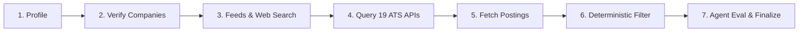

# ULTRON

**U**niversal **L**ocator & **T**riage of **R**oles, **O**penings and **N**iches
(`Universal Locator & Triage of Roles, Openings and Niches`)

[](https://github.com/ERamaM/ULTRON/actions/workflows/ci.yml)
[](https://github.com/ERamaM/ULTRON/actions/workflows/ci.yml?query=branch%3Amain)
[](https://github.com/ERamaM/ULTRON/actions/workflows/codeql.yml)
[](https://www.python.org/downloads/)
[](LICENSE)
[](.gitleaks.toml)
[](https://github.com/astral-sh/ruff)
[](#supported-agents)

ULTRON is a production-ready agent skill and deterministic CLI for **Claude Code, Codex, OpenCode, and Antigravity**. It automates end-to-end job searches for any role family and geographic region: your coding agent supplies reasoning (CV-to-profile drafting, company discovery, web queries, ambiguous-role evaluation, and concise summaries), while a local Python CLI handles high-volume ATS board queries, structured job feeds, strict filtering, scoring, deduplication, ledger history, and exports.

## Highlights

- **Any role, any region:** Works across engineering, AI/ML, product, finance, operations, industrial R&D, and more, in Europe, the Americas, APAC, or global remote markets.
- **Zero-Python bootstrap:** `install.sh` and `install.ps1` automatically provision standalone `uv` and Python 3.12 if your machine does not have Python installed.
- **19 direct ATS integrations + structured feeds:** Fetches live openings straight from vendor APIs and aggregates public feeds via `discover feeds`.
- **Hybrid precision & triage:** Deterministic rules discard off-location/off-seniority noise before your agent spends tokens reviewing only genuinely uncertain ("unsure") or high-signal postings.
- **Incremental job ledger & exports:** Tracks seen roles in SQLite across runs, highlights new openings (`jobs new-since`), and exports Markdown, JSON, and Excel (`.xlsx`).
- **Scheduled / zero-token mode:** Run unattended heuristic searches with `ultron run --unattended`.

## Supported Agents

| Agent | Skill Invoke | Default Global Install Path |
| --- | --- | --- |
| **Claude Code** | `/ultron ...` | `~/.claude/skills/ultron` |
| **Codex** | `$ultron ...` | `~/.agents/skills/ultron` |
| **OpenCode** | `ultron ...` | `~/.config/opencode/skills/ultron` |
| **Antigravity** | `ultron ...` | `~/.gemini/config/skills/ultron` |

## Installation

### Option 1 — Zero-Python Bootstrap (Recommended)

No pre-installed Python needed. If Python 3.12+ (with `venv` / `ensurepip`) is absent, the bootstrap script installs standalone [uv](https://docs.astral.sh/uv/) and provisions a managed Python 3.12 runtime automatically (no administrator or `sudo` privileges required):

**macOS / Linux:**

```sh
curl -fsSL https://raw.githubusercontent.com/ERamaM/ULTRON/main/install.sh | sh
```

**Windows (PowerShell):**

```powershell
irm https://raw.githubusercontent.com/ERamaM/ULTRON/main/install.ps1 | iex
```

From a local clone, you can also run `./install.sh` (macOS/Linux) or `powershell -ExecutionPolicy Bypass -File .\install.ps1` (Windows).

### Option 2 — With Python 3.12+ Installed (From a Clone)

<!-- install:start -->
```bash
python install.py
```
<!-- install:end -->

On Linux/macOS use `python3 install.py` (on Debian/Ubuntu without `uv`, install `python3-venv` first).

All installers install globally by default with the `cv` (PDF CV parsing via `pypdf`) and `xlsx` (Excel export via `openpyxl`) extras enabled, auto-detect installed agents, and write `RUNTIME.md` next to `SKILL.md`. Restart your agent (or open a new session) after installing.

### Verify Installation

The `ultron` binary lives inside its dedicated venv (`~/.ultron/venv`) rather than mutating your global `PATH`. Run `doctor`:

- PowerShell: `& "$HOME\.ultron\venv\Scripts\ultron.exe" doctor`
- CMD: `"%USERPROFILE%\.ultron\venv\Scripts\ultron.exe" doctor`
- Linux/macOS: `~/.ultron/venv/bin/ultron doctor`

| Option | Effect |
| --- | --- |
| `--project DIR` | Install into `DIR/.claude` and `DIR/.agents` instead of user folders |
| `--platforms claude,codex` | Target specific agents (`claude`, `codex`, `opencode`, `antigravity`) |
| `--update` | Refresh the virtual environment and existing ULTRON installs |
| `--uninstall` | Remove ULTRON installs (add `--purge-data` to remove `$ULTRON_HOME` data) |
| `--dry-run` | Preview installer changes without updating the venv, skill copies, or saved data. The bootstrap may still download and extract the source or provision `uv` and Python. |

### Updating ULTRON

Updates are manual. From a clone, first update the checkout to the branch or tag you want to install. Then run the bootstrap with `--update` and the same installation scope you used originally.

After an interactive search, ULTRON can check for a newer stable GitHub release once every 24 hours
and show a single note per new version. Set `ULTRON_DISABLE_UPDATE_CHECK=1` to turn off the check.

**macOS / Linux:**

```sh
./install.sh --update
```

**Windows (PowerShell):**

```powershell
powershell -ExecutionPolicy Bypass -File .\install.ps1 --update
```

If you installed from the web, run the appropriate command below from outside any ULTRON checkout. The remote bootstrap downloads `main` by default.

**macOS / Linux:**

```sh
curl -fsSL https://raw.githubusercontent.com/ERamaM/ULTRON/main/install.sh | sh -s -- --update
```

**Windows (PowerShell):**

```powershell
& ([scriptblock]::Create((irm https://raw.githubusercontent.com/ERamaM/ULTRON/main/install.ps1))) --update
```

Add `--project DIR` for a project installation and `--platforms` to limit which agent skill copies are refreshed.

The update refreshes the CLI in `$ULTRON_HOME/venv`, replaces existing skill copies in the selected scope, and rewrites `RUNTIME.md`. Installations that share the same `$ULTRON_HOME` share the updated CLI. Profiles, saved searches, job history, and past run outputs are kept. Add `--dry-run` to preview the installer's targets. The macOS/Linux web bootstrap can leave its extracted source in a temporary directory, including during a preview. After updating, run `version` and `doctor` with the executable listed in `RUNTIME.md`, then start a new agent session to reload the skill.

## How It Works



1. **Profile:** Draft a search profile from a PDF/text CV or adapt the bundled template.
2. **Companies:** Propose target employers and verify their live ATS boards (`ultron seeds verify`).
3. **Discovery:** Pull structured job feeds (`ultron discover feeds` reading `skill/ultron/data/feeds.yaml`) and run targeted web queries (`candidates add`).
4. **ATS Crawl:** Query verified boards across 19 ATS vendors (`discover ats`).
5. **Fetch:** Download job descriptions with vendor API enrichment fallbacks (`fetch`).
6. **Filter:** Apply deterministic role, seniority, language, remote-policy, and geo rules (`filter`).
7. **Evaluate & Finalize:** Have the agent evaluate doubtful (`unsure`) postings, rank results, persist history to `$ULTRON_HOME`, and emit `results.md`, `results.json`, and optional `.xlsx` exports.

## Supported ATS Vendors (19) & Feeds

`Ashby` · `BambooHR` · `Breezy` · `Comeet` · `Factorial` · `Greenhouse` · `Homerun` · `iCIMS` · `JazzHR` · `Jobvite` · `Lever` · `Personio` · `Pinpoint` · `Recruitee` · `SmartRecruiters` · `Taleo` · `Teamtailor` · `Workable` · `Workday`

Public structured feed and curated remote-company list endpoints are configured in `skill/ultron/data/feeds.yaml` and executed by `discover feeds`.

## Search Presets

| Preset | Max Pages | Max Seeds | Web Queries | Ambiguity Threshold | New Companies Target |
| --- | ---: | ---: | ---: | ---: | ---: |
| `fast` | 70 | 120 | 20 | 55 | 10 |
| `balanced` | 400 | 180 | 40 | 50 | 25 |
| `deep` | 4000 | 400 | 120 | 45 | 60 |
| `seed_boost` | 4000 | 400 | 220 | 45 | 120 |

## First Use

Open any supported agent and ask naturally:

- *"Create a search profile from my attached CV and find remote backend roles in Europe."*
- *"Run my saved search again and show only newly posted openings."*

If you ask for an interactive search without choosing a profile, ULTRON lists your options and asks
which one to use. You can also create a profile from a CV or describe the roles, regions, and work
mode you want.

Ask “How does ULTRON work?” for a quick walkthrough and examples of what you can ask next.

### Unattended Mode

```sh
ultron profile install-example
ultron run --unattended --profile ai-ml-remote-eu
```

## Data, Privacy & Security

- **Local-first storage:** Profiles, SQLite ledger, caches, and run outputs live exclusively in `$ULTRON_HOME` (default `~/.ultron`). ULTRON uploads no telemetry.
- **Provider visibility:** Your chosen agent provider processes only what the agent reads (your profile, extracted CV text when drafting a profile, and shortlisted/ambiguous job descriptions).
- **Redaction & untrusted input defense:** Exports redact common API tokens/credentials automatically and sanitize Markdown/spreadsheet cells. See [SECURITY.md](SECURITY.md) for reporting vulnerabilities and security details.

## Development & CI

```sh
uv sync --locked
uv run ruff check
uv run pytest
```

Continuous integration runs Ruff linting, wheel build checks, Gitleaks secret scanning, pytest on Linux, macOS, and Windows (Python 3.12 and 3.13), and end-to-end installer smoke tests. CodeQL scans Python and GitHub Actions on pushes to `main`, on pull requests, and once a week. Dependabot checks for GitHub Actions and `uv` dependency updates. The [CodeRabbit configuration](.coderabbit.yaml) applies after the GitHub app is installed for this repository. See [CONTRIBUTING.md](CONTRIBUTING.md) before opening a pull request.

## License

MIT License — see [LICENSE](LICENSE).
