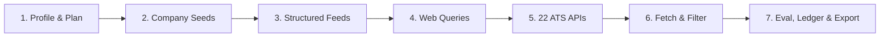

# Searches & Presets

## How a Search Run Works

Every ULTRON search moves through seven staged steps inside `$ULTRON_HOME/runs/<run_id>/`, so partial progress is resumable and prerequisite order is enforced automatically:



1. **Create the run (`ultron run new --profile <slug> --preset <name>`):** Loads your profile, calculates how many fitting company boards already exist in the seed inventory (`eligible_seeds` / `fitting_seeds`), and prints your query plan (`query_plan`) plus any `seed_deficit`.
2. **Propose & verify companies (`ultron seeds plan` -> `ultron seeds verify`):** If your profile has fewer fitting company boards than the preset's `seed_target`, the agent proposes candidate employers and domains in rounds. The CLI probes public careers pages/ATS endpoints (`Greenhouse`, `Lever`, `Ashby`, `Workday`, `SmartRecruiters`, and 17 more) and persists only live, verified boards (`VendorScopedClient` prevents SSRF and tracks vendor health).
3. **Structured feeds (`ultron discover feeds --run <run_id>`):** Pulls structured feeds and remote-company lists configured in [`skill/ultron/data/feeds.yaml`](../../skill/ultron/data/feeds.yaml) to extract additional candidates and seed hints.
4. **Web discovery (`ultron candidates add --run <run_id> --from <jsonl>`):** Your agent runs the preset-capped search queries (plus ATS `site:` queries on cold-start profiles with fewer than 15 fitting seeds) and feeds discovered job links cleanly into the run.
5. **ATS board crawl (`ultron discover ats --run <run_id>`):** Queries the live APIs/job boards of every verified company linked to the profile, respecting per-host and per-vendor rate budgets.
6. **Fetch & deterministic filter (`ultron fetch` -> `ultron filter`):** Downloads full job descriptions and scores them deterministically against title exclusions, seniority, language, geography/remote rules, and role keywords—partitioning candidates into `kept`, `ambiguous`, and `discarded` (saving borderline non-hard-evidence discards whose ambiguity score meets `llm_ambiguity_threshold`, up to 20 per run).
7. **Evaluate & finalize (`ultron evaluate` -> `ultron finalize`):** Your agent scores borderline `ambiguous` postings against the profile rubric, and `finalize` merges verdicts, ranks kept roles, records occurrences in the SQLite ledger (`$ULTRON_HOME/ultron.sqlite3`), and emits `results.md`, `results.json`, plus optional `.xlsx` and `.html` exports.

## Search Presets Explained

Search presets control **how wide ULTRON casts the net**, **how many requests/pages it fetches**, **how aggressive borderline rescue is**, and **how many companies it tries to discover**.

| Preset | Min / Max Roles | Max Pages | Max Seeds | Web Queries | Ambiguity Threshold | New Companies Target | Seed Target (Rounds) | Per-Vendor Request Cap |
| --- | ---: | ---: | ---: | ---: | ---: | ---: | ---: | ---: |
| `fast` | 3 / 5 | 70 | 120 | 20 | 55 | 10 | 35 (2 rounds) | 120 |
| `balanced` **(default)** | 15 / 250 | 400 | 180 | 40 | 50 | 25 | 75 (3 rounds) | 400 |
| `deep` | 15 / 250 | 4000 | 400 | 120 | 45 | 60 | 100 (3 rounds) | 1200 |
| `seed_boost` | 15 / 250 | 4000 | 400 | 220 | 45 | 120 | 130 (4 rounds) | 1200 |

### When to Choose Each Preset

- **`fast`:** Quick smoke test or daily delta check on an already well-seeded profile. Fetches at most 70 pages, stops once up to 5 top roles are found (`min_roles: 3`, `max_roles: 5`), and only asks for 10 new companies.
- **`balanced` (default):** Everyday search preset balancing coverage, runtime, and token cost—queries up to 180 seeds, 40 web queries, 400 fetched pages, and targets 75 fitting boards (adding up to 25 new companies if needed).
- **`deep`:** Thorough search when you want maximum market coverage or haven't searched in weeks. Raises page fetch cap to 4,000, web queries to 120, vendor cap to 1,200, lowers `llm_ambiguity_threshold` from `50` to `45` so more borderline postings reach agent review, and aims for 100 fitting seeds (up to 60 new companies).
- **`seed_boost`:** Designed for brand-new profiles, underrepresented regions, or niche role families that lack pre-bundled companies. Runs up to 220 web queries and 4 seed-discovery rounds aiming for 130 fitting boards and up to 120 newly verified companies.

### What Key Preset Columns Mean

- **Max Pages (`max_pages`):** Cap on posting HTML pages downloaded during `fetch` (ATS API JSON calls are additionally governed by `max_requests_per_host`, `max_requests_per_vendor`, and overall run client budget `max_pages + max_seeds_per_run * 2`).
- **Max Seeds / Seed Target (Rounds):** `max_seeds_per_run` limits how many boards `discover ats` queries; `seed_target` is the desired count of fitting verified boards before crawling, populated across up to `seed_rounds` agent proposal rounds.
- **Ambiguity Threshold (`llm_ambiguity_threshold`):** Heuristic score threshold (out of 100) for rescuing borderline evaluator discards without hard exclusions (`expired_or_closed`, `location_excluded`, `outside_ats_allowlist`) into `ambiguous` review instead of final discard. Lowering it (e.g., `45` in `deep`) lets the AI agent review more edge cases.
- **New Companies Target (`new_companies_per_run`):** Maximum new employers to verify and add per run to grow your local seed inventory over time.

## Customizing Preset Limits

When creating a saved search, you can override individual preset keys with `--override KEY=VALUE`:

```sh
ultron saved-search create weekly-deep --profile my-profile --preset deep --override max_pages=1500 --override llm_ambiguity_threshold=42
```

Every override key, type, and bound is validated (`PresetOverrideError` if invalid).

## Diagnosing Missed or Dropped Postings

If an expected job URL did not appear in your final shortlist, inspect which exact filter or stage dropped it:

```sh
ultron diagnose "https://boards.greenhouse.io/company/jobs/12345" --profile <slug> [--run <run_id>]
```

Add `--no-fetch` to replay strictly against cached data without making a network request.

Next: [Unattended & Scheduling](unattended-and-scheduling.md).
